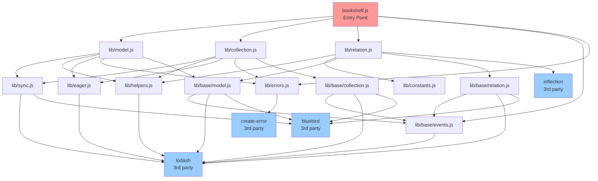
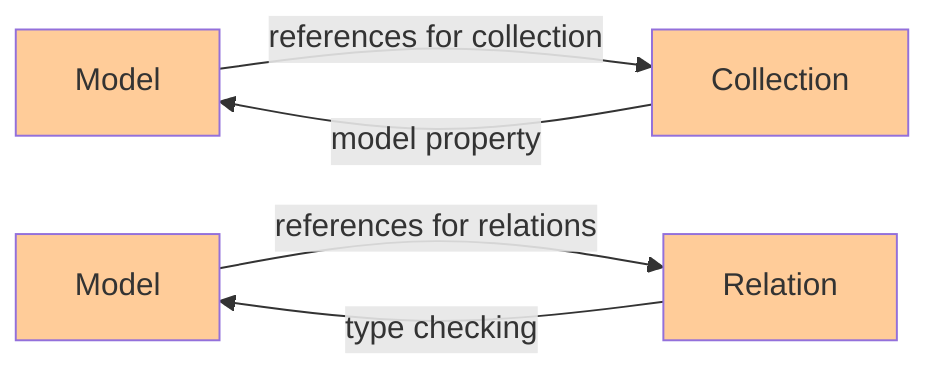
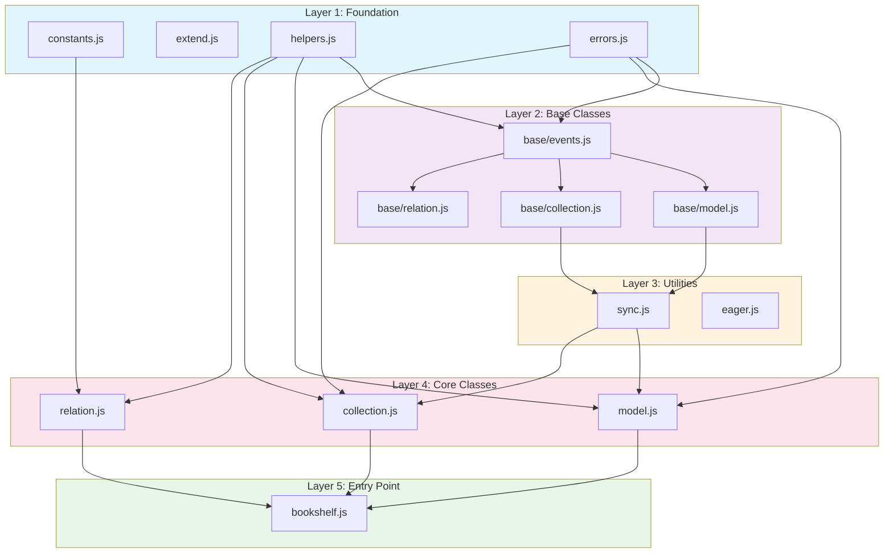
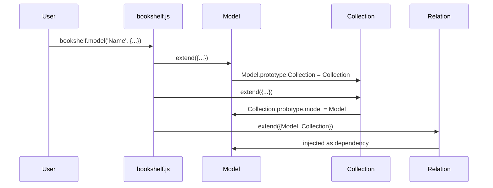
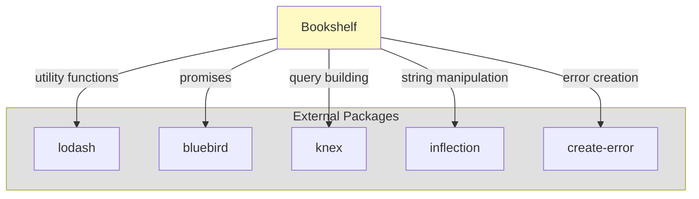
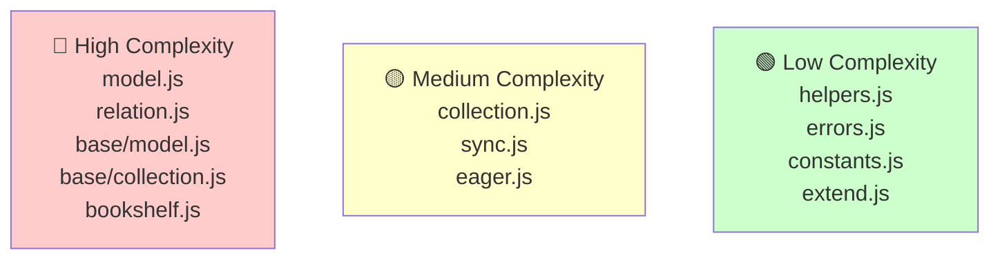

# Bookshelf.js - Visual Dependency Graph (Mermaid)

This file contains Mermaid diagrams showing the dependencies in Bookshelf.js

## Main Module Dependencies

## Circular Dependencies

## Dependency Layers

## Data Flow: Model Creation

## External Package Integration

## Complexity Hierarchy

